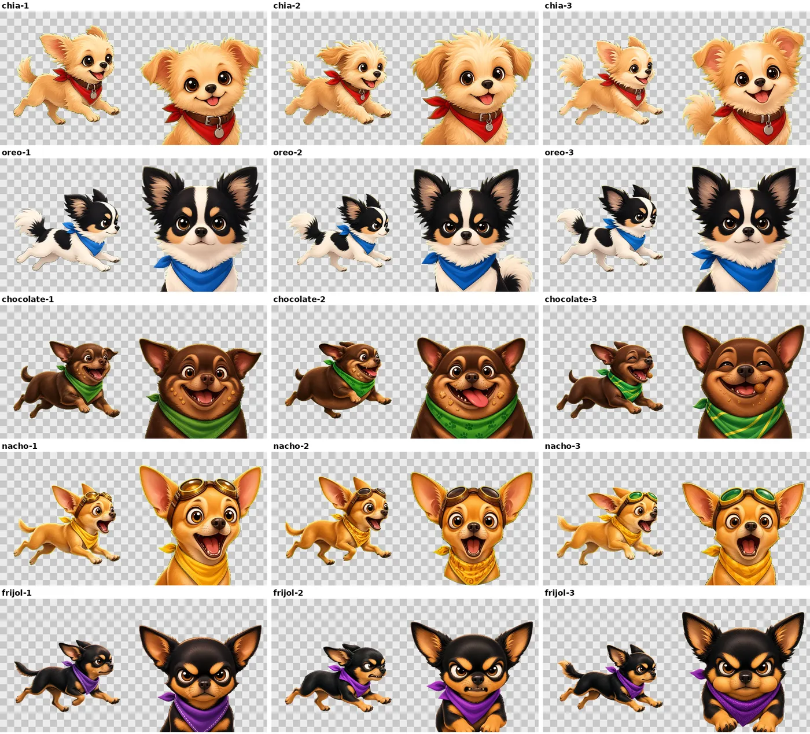
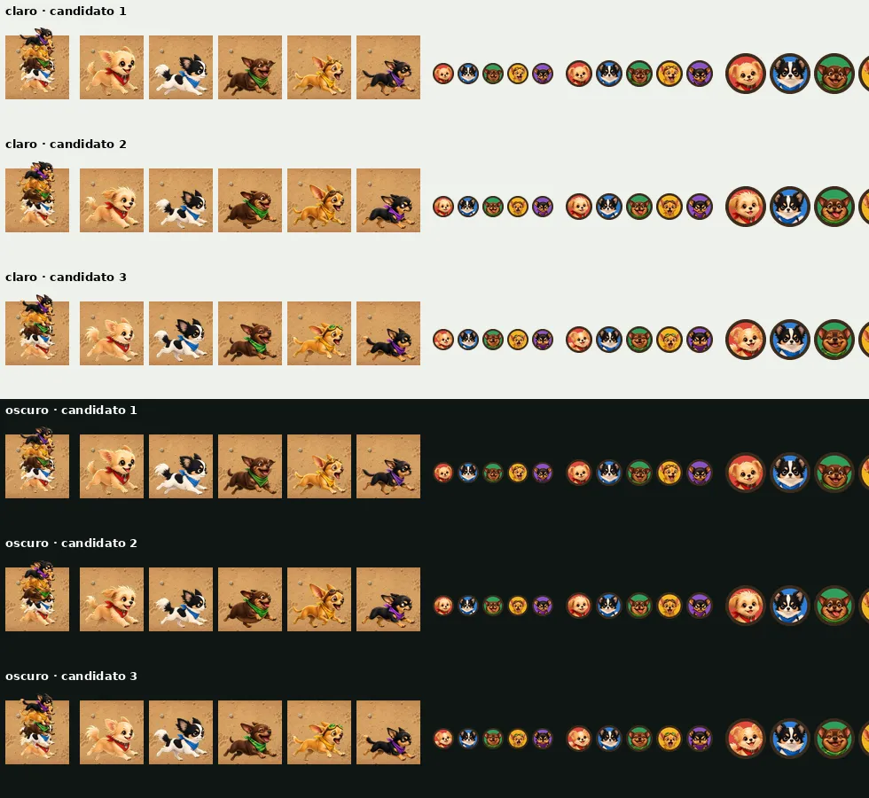
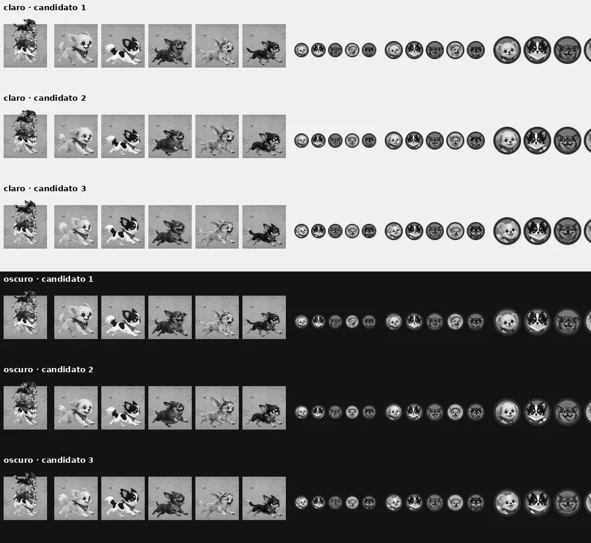
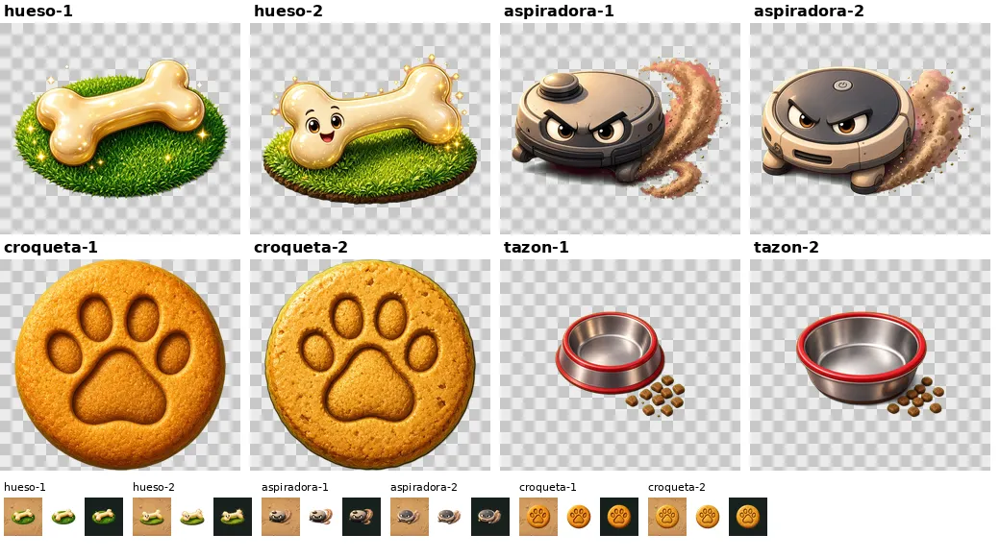
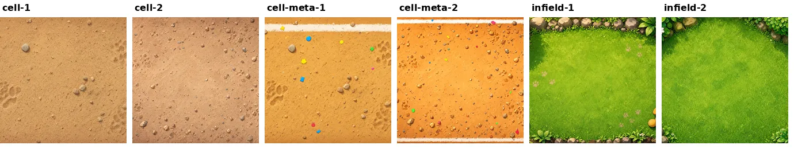
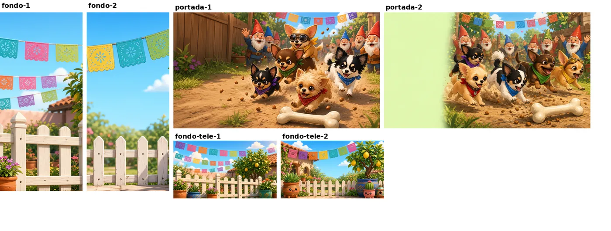
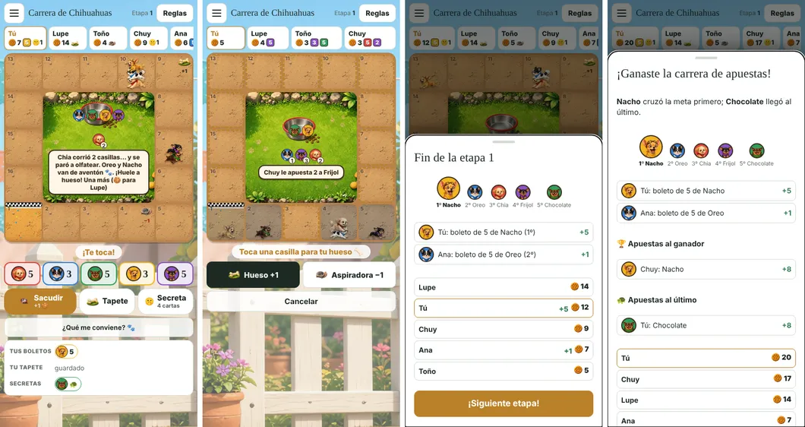
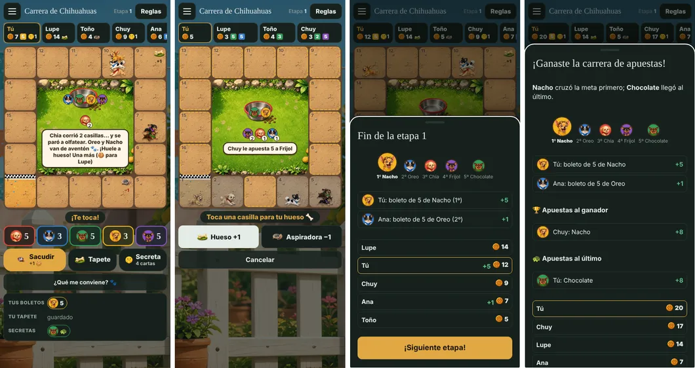

# Imágenes de la Carrera de Chihuahuas

Diseño de Petra (issue #33), elección e integración de Claude (issue #34). Los 50 candidatos (maestros en alta) y sus
prompts están en la rama `chihuahuas-candidatos` (`games/chihuahuas/assets/candidatos/`, con `prompts.md`); los
elegidos, ya en tamaño de teléfono, viven en `games/chihuahuas/assets/`. Fotos de referencia de los perros de la familia (Chia y Oreo; Gustavo y Catrina, que reemplazan a Nacho y Frijol) en
[`referencia/`](referencia/).

## Elección

| Llave | Elegido | Llave | Elegido |
|---|---|---|---|
| Chia (perro y cara) | `chia-2` | `hueso` | `hueso-2` |
| Oreo | `oreo-1` | `aspiradora` | `aspiradora-2` |
| Chocolate | `chocolate-2` | `croqueta` | `croqueta-1` |
| Nacho | `nacho-1` | `tazon` | `tazon-2` |
| Frijol | `frijol-2` | `cell`, `cell-meta` | `cell-1`, `cell-meta-1` |
| `infield` | `infield-1` | `fondo` (y `fondo-tele-1` para la tele, #35) | `fondo-1` |
| `portada` | `portada-1` | | |

**Formato:** los 50 cumplen: tamaños pedidos, transparencia limpia (sin restos del magenta ni del verde del recorte:
lo verde y morado que aparece es el paliacate y el pasto), sin texto ni marcas.

### Perros

Tamaño grande, perro y cara de cada candidato:

Como se ven en la pista (una pila de los cinco a 40 px y cada uno a 60 px sobre la casilla) y las caras a 24, 30 y
46 px dentro del círculo de su color, en tema claro y oscuro:

En gris:

Los quince candidatos se distinguen a 40 px; el pelo separa a los perros antes que el paliacate. Los dos más
parecidos en gris son Chia y Nacho (claros) y Chocolate y Frijol (oscuros); se separan por la silueta (pelo esponjado
contra orejotas con goggles) y por las marcas color fuego de Frijol. Los cinco comparten encuadre y línea de patas
(85 % de la altura): se recortaron todos con la misma caja (patas en la orilla de abajo), así que apilados quedan
parejos.

- **`chia-2`**: la más despeinada y de orejas caídas, como la Chia de la foto (Petra también la recomienda); su cara es
  la más parecida.
- **`oreo-1`**: cuerpo blanco con manchas negras (en la foto Oreo es sobre todo blanco), franja blanca ancha en la
  frente, antifaz y orejas negras con fleco claro. `oreo-3` trae una sombra semitransparente.
- **`chocolate-2`**: la cara más chistosa (lengua de fuera y migajas) y bien gordito corriendo. `chocolate-3` tiene los
  ojos cerrados, que a 24 px se pierden.
- **`nacho-1`**: gritando con la boca abierta, orejas enormes y goggles café. `nacho-3` lleva goggles verdes, que
  chico se confunden con el paliacate de Chocolate.
- **`frijol-2`**: el más enojón (enseña los dientes) y la silueta más clara corriendo.

### Cosas, pista y fondos

- **`hueso-2`**: el hueso con carita, más chistoso; chico se lee igual que el otro.
- **`aspiradora-2`**: la tapa oscura contrasta mejor sobre la tierra a 26 px, y `aspiradora-1` trae sombra
  semitransparente y polvo rosado (nota de Petra). Su símbolo de encendido no es texto.
- **`croqueta-1`**: orilla limpia; `croqueta-2` tiene un filo amarillo.
- **`tazon-2`**: más ancho, deja más lugar para las caras de los dados.

- **`cell-1` y `cell-meta-1`**: tierra pareja con huellas, centro tranquilo para los perros; `cell-2` trae rastro del
  marco y `cell-meta-2` líneas de gis en los cuatro lados.
- **`infield-1`**: huellas y juguetes en las orillas, centro liso donde van el tazón y la burbuja.

- **`fondo-1`**: ya viene suave; en la mesa lleva además un velo del color de la página para que los botones y
  textos se lean. `fondo-2` es nítido y con caritas en las macetas: compite con la mesa.
- **`portada-1`**: la más chistosa (gnomos, croquetas volando, Nacho con goggles). Va arriba de las reglas, donde no
  hace falta el espacio para título de `portada-2`, cuyo tercio verde liso se ve sin terminar.

## La mesa (390 px: pila con tapetes, escoger casilla, fin de etapa, final)

Claro:

Oscuro:

