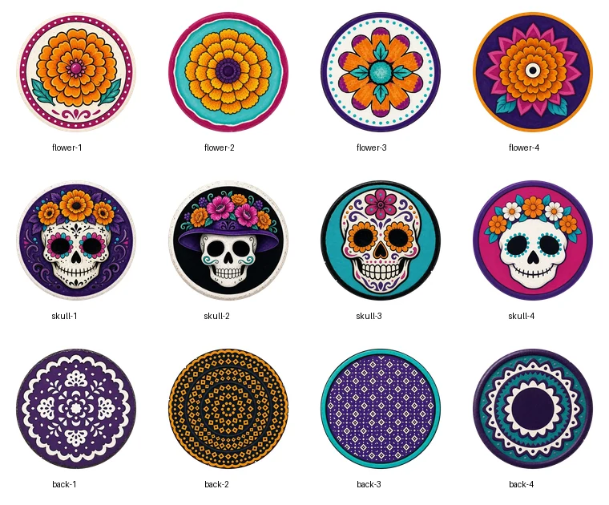
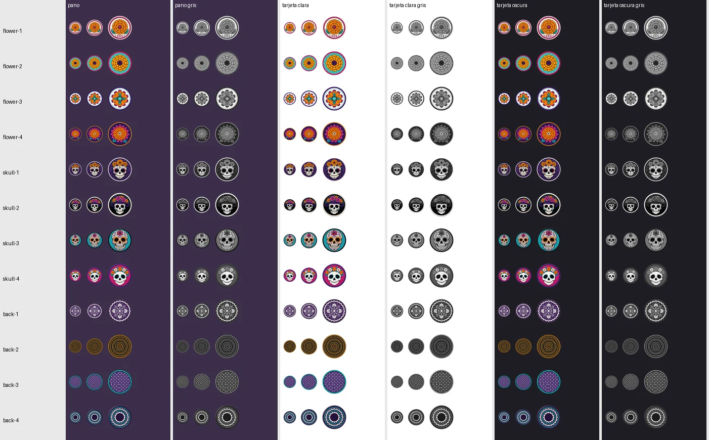
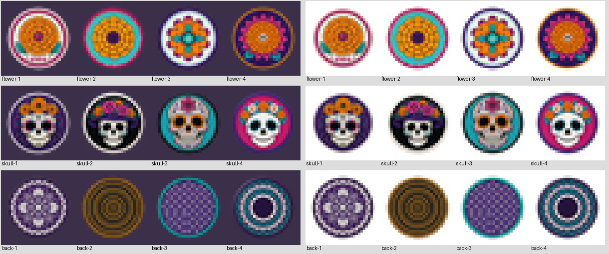
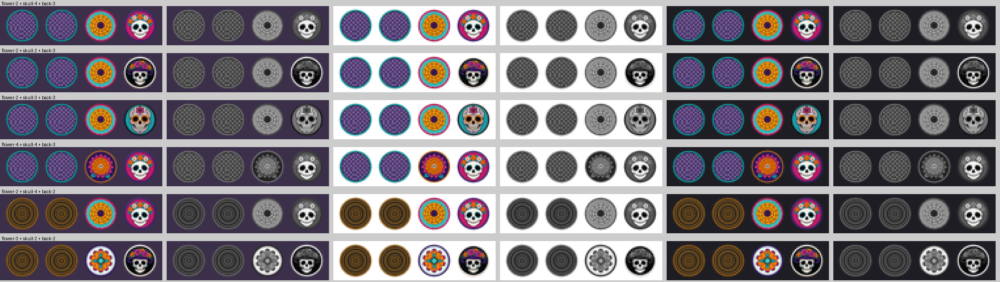
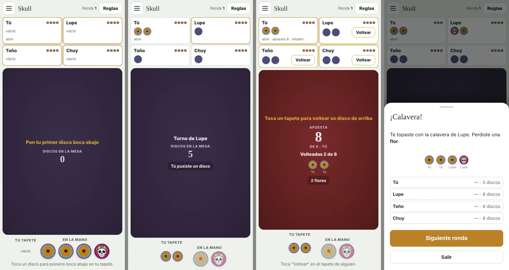
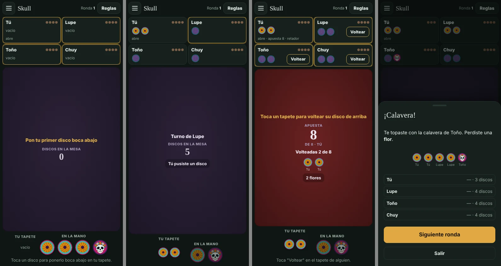

# Discos de Skull con temática de catrinas

Diseño de Petra (issue #25), elección e integración de Claude (issue #26, PR #29). Los 12 candidatos y sus prompts
están en [`candidatos/`](candidatos/) (`prompts.md`); los tres elegidos viven en `games/skull/assets/`.

## Elección: `flower-2` + `skull-4` + `back-3`

Se revisaron los 12 candidatos de Petra.

**Formato:** los 12 cumplen: 512 × 512, nada opaco fuera del círculo, nada transparente adentro, 36–59 KB, sin texto. Los bordes claros de `flower-1`, `skull-1` y `skull-2` son su orilla color hueso, no halos del recorte.

### Hojas de contacto

Tamaño completo:

A 26, 34 y 50 px sobre el paño, una tarjeta clara y una oscura, en color y en gris:

Cada uno a 26 px, ampliado sin suavizar (así se ve de verdad en el tapete de los demás):

Tríos como se ven en un tapete ajeno a 26 px (reverso, reverso, flor, calavera); la primera fila es la elegida:

### Por qué ganó cada uno

- **`skull-4`**: la cara más grande y más blanca de las cuatro, sobre magenta, con borde morado oscuro. A 26 px es la que se lee más rápido como calavera, también en gris (cara blanca sobre gris medio). Su magenta no lo usa ninguna otra cara.
- **`flower-2`**: flor naranja que llena el disco sobre turquesa, con centro oscuro. A 26 px es un "sol" naranja inconfundible; en gris queda gris claro con punto oscuro, distinto de la cara blanca de la calavera y de la textura del reverso.
- **`back-3`**: retícula pareja morada con orilla turquesa, sin ninguna forma al centro. A 26 px es una textura sin figura: no parece flor ni calavera, y en gris es el más oscuro y uniforme de los tres.

Juntos: tres colores dominantes distintos (naranja, magenta con blanco y morado) y tres luminosidades distintas en gris. Comparten paleta y estilo de cerámica pintada.

### Por qué no los demás

- `flower-1` y `flower-3`: disco blanco. En gris, a 26 px, se acercan a la calavera (mucho blanco con algo oscuro al centro). `flower-1` además tiene orilla clara que se pierde en la tarjeta clara.
- `flower-4`: fondo morado oscuro, el mismo tono del reverso y del paño; a 26 px pierde contraste.
- `skull-1`: buena, pero su fondo morado se confunde con el reverso, y la corona de flores naranjas es grande: a 26 px la parte de arriba parece flor.
- `skull-2`: muy contrastada, pero su orilla color hueso desaparece sobre la tarjeta clara (el issue pide borde oscuro) y el sombrero ocupa casi la mitad del disco.
- `skull-3`: fondo turquesa, el mismo de la flor; los ojos rodeados de naranja la acercan a la flor. En gris la cara queda gris, no blanca.
- `back-1` y `back-4`: parecen flor o roseta (de acuerdo con Petra).
- `back-2`: naranja sobre negro; el naranja es el color de la flor y a 26 px se ve como un disco naranja.

## La mesa con los discos elegidos (390 px: inicio, tapetes, reto, resultado)

Claro:

Oscuro:

